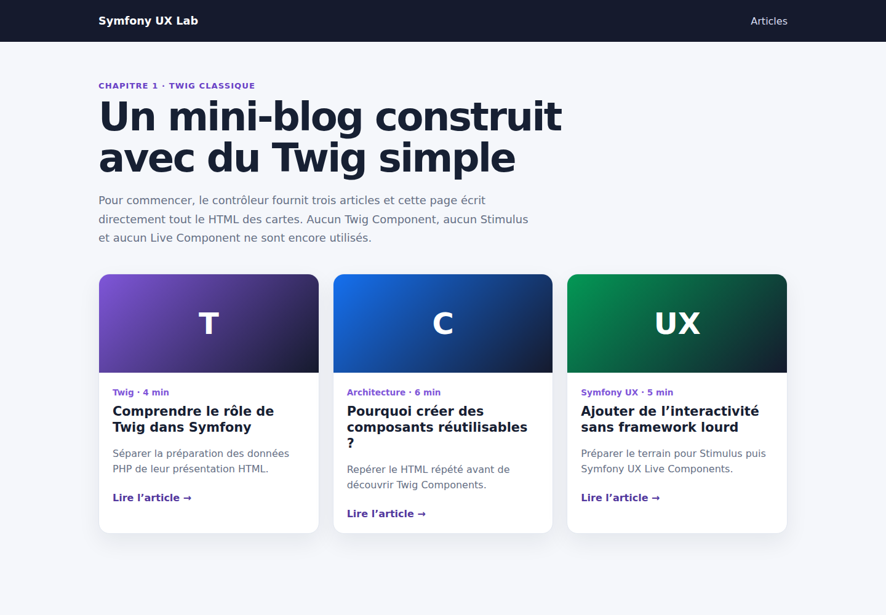

# Symfony et Twig classique : construire un mini-blog avant les composants

Avant de découvrir Twig Components, Stimulus ou Live Components, il est utile de repartir du fonctionnement le plus simple de Symfony : un contrôleur prépare des données et un template Twig fabrique le HTML.

Dans ce premier laboratoire, nous construisons un mini-blog sans base de données et sans composant UX. Cette version volontairement classique servira de point de comparaison pour les chapitres suivants.

Le code complet est disponible sur GitHub :

<https://github.com/amine-betari/symfony-ux-lab>

## Démarrer le laboratoire

Installer les dépendances puis démarrer FrankenPHP :

```bash
docker run --rm \
  --user "$(id -u):$(id -g)" \
  -e COMPOSER_HOME=/tmp/composer \
  -v "$PWD:/app" \
  -w /app \
  composer:2 install

docker compose up -d
```

La page est disponible à l'adresse suivante :

<http://localhost:8480/articles>



## Le circuit le plus simple

Le navigateur appelle une URL. Symfony trouve le contrôleur correspondant. Le contrôleur transmet des données à Twig, puis Twig génère la réponse HTML.

```text
GET /articles
      ↓
ArticleController
      ↓ fournit le tableau articles
article/index.html.twig
      ↓
HTML envoyé au navigateur
```

FrankenPHP est le serveur HTTP de ce laboratoire. Nous n'utilisons ni le serveur Symfony CLI, ni Nginx, ni PHP-FPM.

## Déclarer la route et préparer les données

Pour ce premier exemple, les articles sont stockés dans un tableau PHP. Cela évite d'introduire Doctrine avant d'avoir compris le rendu.

```php
#[Route('/articles', name: 'app_articles', methods: ['GET'])]
public function index(): Response
{
    return $this->render('article/index.html.twig', [
        'articles' => self::ARTICLES,
    ]);
}
```

La méthode `render()` reçoit deux informations :

- le nom du template à utiliser ;
- les variables accessibles dans ce template.

La clé `articles` devient donc la variable Twig `articles`.

Le contrôleur ne construit pas lui-même le HTML. Son rôle est de recevoir la requête, préparer les données et choisir la réponse.

## Parcourir les articles dans Twig

Le template étend d'abord la mise en page générale :

```twig

```

Il parcourt ensuite les données fournies par le contrôleur :

```twig

    <article class="article-card">
        <h2>{{ article.title }}</h2>
        <p>{{ article.excerpt }}</p>

        <a href="{{ path('app_article_show', {
            slug: article.slug
        }) }}">
            Lire l'article
        </a>
    </article>

```

Trois syntaxes importantes apparaissent :

```text
  exécute une instruction Twig
{{ ... }}  affiche une valeur
{# ... #}  écrit un commentaire non envoyé au navigateur
```

Par défaut, Twig échappe les valeurs affichées. Un titre contenant du HTML arbitraire n'est donc pas exécuté directement dans la page.

## Générer une URL avec le nom de route

La fonction `path()` utilise le nom de la route plutôt qu'une adresse écrite manuellement :

```twig
{{ path('app_article_show', {slug: article.slug}) }}
```

Symfony produit par exemple :

```text
/articles/comprendre-twig
```

Si le chemin de la route change plus tard, le template continue de fonctionner tant que son nom reste identique.

## Afficher un article

La route de détail reçoit le slug présent dans l'URL :

```php
#[Route('/articles/{slug}', name: 'app_article_show', methods: ['GET'])]
public function show(string $slug): Response
{
    foreach (self::ARTICLES as $article) {
        if ($article['slug'] === $slug) {
            return $this->render('article/show.html.twig', [
                'article' => $article,
            ]);
        }
    }

    throw $this->createNotFoundException('Article introuvable.');
}
```

Une adresse inconnue produit une véritable réponse HTTP `404`.

## Tester la page générée

Un test fonctionnel appelle la route comme le ferait un navigateur et inspecte le HTML avec DomCrawler :

```php
public function testArticleListUsesClassicTwigMarkup(): void
{
    $client = static::createClient();
    $crawler = $client->request('GET', '/articles');

    self::assertResponseIsSuccessful();
    self::assertCount(3, $crawler->filter('.article-card'));
}
```

Nous vérifions également l'ouverture d'un article et le statut `404` d'un slug inconnu.

Lancer les tests :

```bash
docker compose exec app php bin/phpunit
```

## Pourquoi cette solution ne suffit-elle pas toujours ?

Cette version est correcte pour une petite page. Le problème apparaît lorsque la même carte doit être affichée dans plusieurs endroits : accueil, recherche, favoris ou administration.

Il faudrait recopier ce bloc :

```twig
<article class="article-card">
    <!-- titre, catégorie, description et lien -->
</article>
```

Une modification visuelle devrait alors être répétée dans chaque copie. Les pages pourraient finir par afficher des variantes involontairement différentes.

Un simple `` peut déjà extraire du HTML. Twig Components apporte en plus un composant nommé, des propriétés explicites, une convention de templates et des outils de test dédiés.

## Conclusion

Ce premier chapitre ne cherche volontairement rien de spectaculaire. Il fixe le fonctionnement de base :

```text
le contrôleur prépare
Twig présente
le navigateur reçoit du HTML
```

Le chapitre suivant conserve exactement le même contrôleur et le même résultat visuel, mais extrait la carte répétée dans un composant `ArticleCard` réutilisable.
