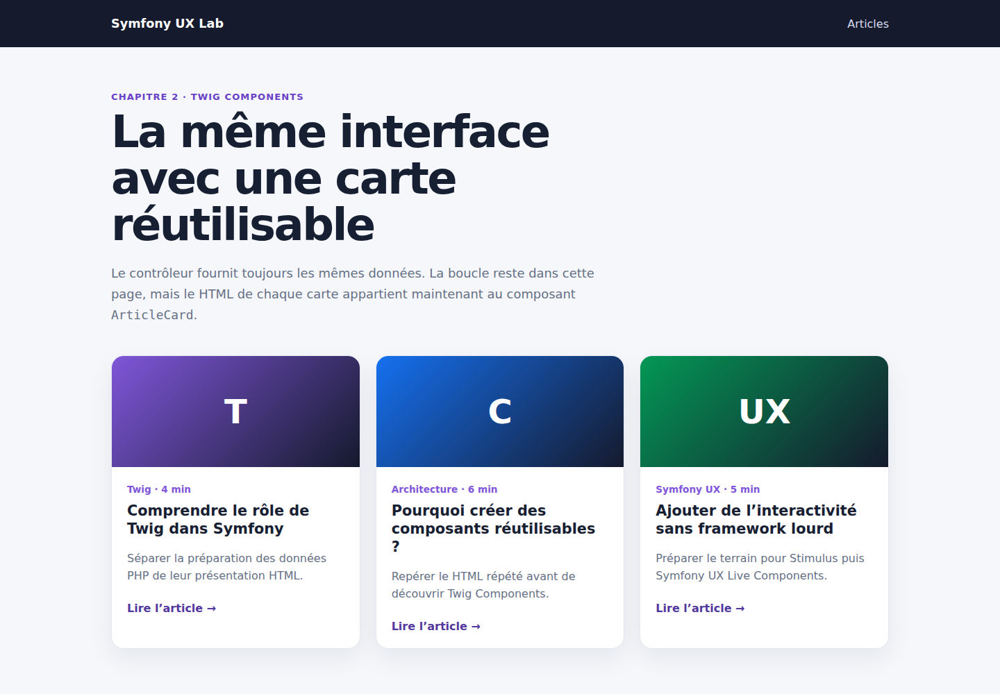

# Symfony UX Twig Components : extraire une carte d'article réutilisable

Dans le premier chapitre, notre page `/articles` écrivait directement tout le HTML de chaque carte dans une boucle Twig. Cette solution fonctionne, mais elle devient difficile à maintenir lorsque la même interface apparaît sur plusieurs pages.

Nous allons conserver les mêmes données, le même contrôleur et le même rendu, puis déplacer seulement la responsabilité de la carte dans un Twig Component.

Le code complet est disponible sur GitHub :

<https://github.com/amine-betari/symfony-ux-lab>

## Le résultat

Démarrer le laboratoire puis ouvrir :

<http://localhost:8480/articles>



Visuellement, presque rien ne change. La différence concerne l'organisation du code.

## Installer Twig Components

Le composant est fourni par Symfony UX :

```bash
composer require symfony/ux-twig-component
```

Dans notre environnement Docker, la même commande peut être lancée avec l'image Composer :

```bash
docker run --rm \
  --user "$(id -u):$(id -g)" \
  -e COMPOSER_HOME=/tmp/composer \
  -v "$PWD:/app" \
  -w /app \
  composer:2 require symfony/ux-twig-component
```

La recette Symfony configure automatiquement le namespace `App\Twig\Components` et le dossier `templates/components/`.

## Avant : le HTML appartient à la page

La boucle possédait toute la structure :

```twig

    <article class="article-card">
        <h2>{{ article.title }}</h2>
        <p>{{ article.excerpt }}</p>
        {# reste de la carte #}
    </article>

```

La page devait donc connaître chaque détail du rendu de la carte.

## Créer la classe du composant

Nous ajoutons `src/Twig/Components/ArticleCard.php` :

```php
namespace App\Twig\Components;

use Symfony\UX\TwigComponent\Attribute\AsTwigComponent;

#[AsTwigComponent]
final class ArticleCard
{
    public array $article = [];
}
```

L'attribut `#[AsTwigComponent]` enregistre la classe comme un composant Twig nommé `ArticleCard`.

La propriété publique `$article` représente la donnée que le template parent doit fournir au composant. Pour cette première découverte, nous transmettons le tableau complet. Un prochain chapitre pourra remplacer ce tableau par des propriétés typées plus précises.

## Donner son template au composant

Le fichier `templates/components/ArticleCard.html.twig` contient maintenant la structure de la carte :

```twig
<article class="article-card">
    <div class="article-card__visual"
         style="--accent: {{ article.accent }}">
        {{ article.icon }}
    </div>

    <div class="article-card__body">
        <span>{{ article.category }} · {{ article.readingTime }} min</span>
        <h2>{{ article.title }}</h2>
        <p>{{ article.excerpt }}</p>

        <a href="{{ path('app_article_show', {slug: article.slug}) }}">
            Lire l'article
        </a>
    </div>
</article>
```

Ce template accède directement à la propriété `$article` de la classe du composant.

## Appeler le composant depuis la page

La boucle devient beaucoup plus courte :

```twig

    <twig:ArticleCard :article="article" />

```

Le préfixe `twig:` indique que nous appelons un Twig Component.

Le caractère `:` placé devant `article` est important :

```twig
:article="article"
```

Il demande à Twig d'évaluer la variable `article`. Sans les deux-points, le composant recevrait simplement la chaîne de caractères littérale `"article"`.

## Le nouveau circuit

```text
ArticleController
      ↓ fournit articles
index.html.twig
      ↓ boucle et appelle <twig:ArticleCard>
ArticleCard.php
      ↓ reçoit la prop article
ArticleCard.html.twig
      ↓ produit le HTML de la carte
navigateur
```

Le contrôleur n'a pas changé. Twig Components organise la présentation ; il ne remplace ni le routage, ni le contrôleur, ni la logique métier.

## Tester le composant indépendamment

Le trait `InteractsWithTwigComponents` permet de rendre un composant sans passer par toute la page :

```php
final class ArticleCardTest extends KernelTestCase
{
    use InteractsWithTwigComponents;

    public function testItRendersAnArticleCard(): void
    {
        self::bootKernel();

        $rendered = $this->renderTwigComponent('ArticleCard', [
            'article' => [
                'slug' => 'tester-un-composant',
                'title' => 'Tester un composant Twig',
                'excerpt' => 'Le composant est rendu indépendamment.',
                'category' => 'Tests',
                'readingTime' => 3,
                'icon' => 'T',
                'accent' => '#7f56d9',
            ],
        ]);

        $crawler = $rendered->crawler();

        self::assertCount(1, $crawler->filter('article.article-card'));
        self::assertSame('Tester un composant Twig', $crawler->filter('h2')->text());
    }
}
```

Ce test vérifie le contrat HTML du composant avec ses véritables classe PHP et template Twig.

Le test fonctionnel de `/articles` reste également présent. Nous couvrons ainsi deux niveaux :

```text
test du composant isolé
        +
test de la page qui assemble trois composants
```

## La valeur ajoutée réelle

La carte possède maintenant un nom et un emplacement uniques. Une autre page peut la réutiliser avec une ligne :

```twig
<twig:ArticleCard :article="article" />
```

Une correction du HTML ou de l'accessibilité est appliquée à tous les endroits qui utilisent ce composant.

Cette extraction n'est cependant pas obligatoire pour chaque balise. Un composant est surtout pertinent lorsqu'un bloc :

- est réutilisé ;
- possède un rôle clair dans l'interface ;
- accepte des données ou des variantes ;
- mérite un test indépendant.

## Twig Component n'est pas Live Component

Notre `ArticleCard` est rendu sur le serveur pendant la requête HTTP. Une fois la page reçue, il ne communique plus avec Symfony.

```text
Twig Component → organisation et rendu HTML serveur
Live Component → interactions qui peuvent rappeler Symfony
```

Nous ajouterons Live Components seulement après avoir étudié les propriétés, les attributs HTML et Stimulus.

## Conclusion

Nous sommes passés d'un bloc HTML directement intégré dans une page à un composant nommé, réutilisable et testable :

```twig
<twig:ArticleCard :article="article" />
```

L'interface n'est pas devenue plus dynamique. Le code est devenu mieux organisé. C'est la première valeur de Twig Components, avant toute notion de temps réel ou d'interactivité.
