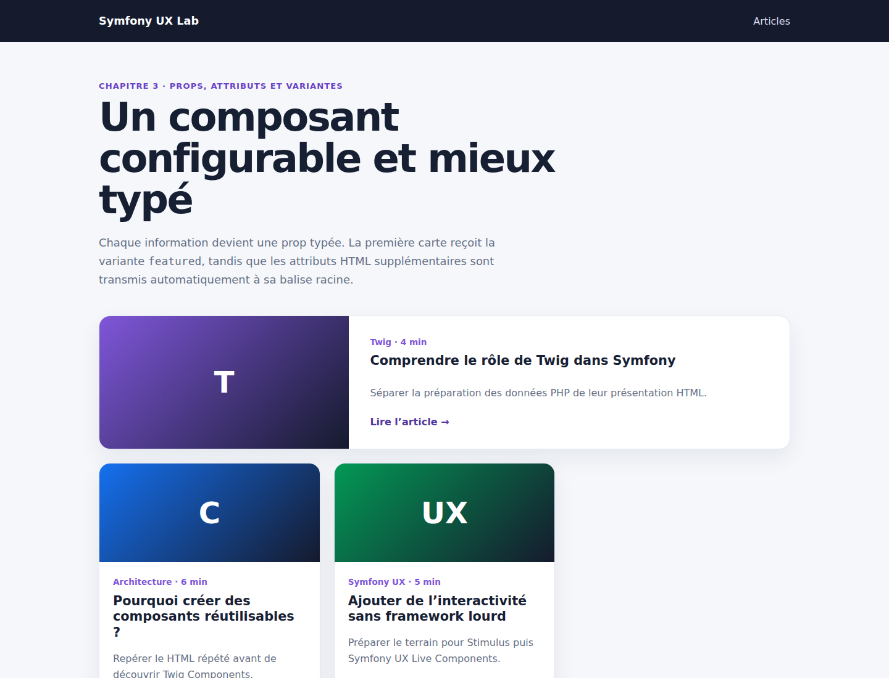

# Symfony UX Twig Components : props typées, attributs HTML et variantes

Notre premier `ArticleCard` recevait l'article complet dans une seule propriété de type tableau. Cette approche permet de découvrir rapidement Twig Components, mais elle ne décrit pas précisément les données attendues et offre une seule apparence.

Dans ce chapitre, nous conservons le même composant et le même contrôleur. Nous améliorons uniquement son contrat et sa capacité de configuration avec trois notions : les props typées, le sac `attributes` et une variante visuelle.

Le code complet est disponible sur GitHub :

<https://github.com/amine-betari/symfony-ux-lab>

## Le résultat

Démarrer le laboratoire puis ouvrir :

<http://localhost:8480/articles>



La première carte occupe toute la largeur avec la variante `featured`. Les deux suivantes utilisent l'apparence `default`. Les trois instances sont pourtant rendues par le même composant `ArticleCard`.

## La limite du tableau unique

Notre première version déclarait une seule propriété :

```php
#[AsTwigComponent]
final class ArticleCard
{
    public array $article = [];
}
```

Puis la page transmettait le tableau complet :

```twig
<twig:ArticleCard :article="article" />
```

Cette classe indique seulement qu'elle accepte un tableau. Elle ne permet pas de savoir immédiatement si le composant attend un titre, un slug, une catégorie ou un temps de lecture.

## Déclarer des props typées

Nous remplaçons le tableau par des propriétés explicites :

```php
#[AsTwigComponent]
final class ArticleCard
{
    public string $slug;
    public string $title;
    public string $excerpt;
    public string $category;
    public int $readingTime;
    public string $icon;
    public string $accent;
    public string $variant = 'default';
}
```

La classe constitue maintenant un contrat lisible :

```text
slug, title, excerpt, category, icon, accent → chaînes de caractères
readingTime                                  → entier
variant                                      → chaîne, default par défaut
```

Une propriété sans valeur par défaut est obligatoire lors du rendu. Le type PHP aide également à détecter une donnée incohérente plus tôt.

## Fournir les props depuis la page

L'appel devient plus détaillé :

```twig
<twig:ArticleCard
    :slug="article.slug"
    :title="article.title"
    :excerpt="article.excerpt"
    :category="article.category"
    :readingTime="article.readingTime"
    :icon="article.icon"
    :accent="article.accent"
/>
```

Le caractère `:` demande à Twig d'évaluer l'expression située à droite :

```twig
:title="article.title"
```

Sans `:`, le composant recevrait le texte littéral `article.title` au lieu du véritable titre.

Cette écriture est plus longue que le tableau unique, mais elle rend les dépendances du composant visibles à l'endroit où il est utilisé.

## Ajouter une variante

Nous voulons mettre en valeur le premier article sans créer un second composant presque identique.

La boucle Twig connaît déjà la variable `loop.first`. Elle peut donc choisir la variante :

```twig
:variant="loop.first ? 'featured' : 'default'"
```

La première itération transmet `featured`. Toutes les autres transmettent `default`.

Dans le template du composant, la variante complète une classe CSS :

```twig
class="article-card article-card--{{ variant }}"
```

Nous obtenons ainsi :

```html
<article class="article-card article-card--featured">
```

ou :

```html
<article class="article-card article-card--default">
```

Le CSS modifie uniquement la disposition de la version mise en avant :

```css
.article-card--featured {
    display: grid;
    grid-column: 1 / -1;
    grid-template-columns: minmax(260px, .85fr) 1.5fr;
}
```

Une variante représente une différence prévue par le design. Il faut éviter de créer une nouvelle variante pour chaque détail ponctuel.

## Comprendre le sac attributes

Une page peut avoir besoin d'ajouter un identifiant, une classe, un attribut ARIA ou une information `data-*` sans que le composant déclare une prop pour chaque attribut HTML possible.

Lors de l'appel, nous ajoutons :

```twig
data-card-index="{{ loop.index }}"
```

Twig Components place les attributs qui ne correspondent pas à une prop dans l'objet spécial `attributes`.

Le template les applique sur sa balise racine :

```twig
<article {{ attributes.defaults({
    class: 'article-card article-card--' ~ variant
}) }}>
```

`defaults()` fournit la classe de base du composant tout en conservant les attributs transmis par la page.

Le HTML final contient les deux :

```html
<article
    class="article-card article-card--featured"
    data-card-index="1"
>
```

Ce mécanisme est particulièrement utile pour :

- `id` ;
- `class` ;
- `aria-label` et les autres attributs d'accessibilité ;
- `data-*` pour les tests ou Stimulus ;
- `title` ou `role`.

## Adapter le template aux props

Le template n'utilise plus `article.title`, mais directement la propriété `title` :

```twig
<span class="article-card__meta">
    {{ category }} · {{ readingTime }} min
</span>

<h2>{{ title }}</h2>
<p>{{ excerpt }}</p>

<a href="{{ path('app_article_show', {slug}) }}">
    Lire l'article
</a>
```

Le composant reste chargé de la présentation. Le contrôleur continue à fournir exactement le même tableau d'articles qu'auparavant.

## Tester la variante et l'intégration

Le test isolé rend explicitement la variante `featured` :

```php
$rendered = $this->renderTwigComponent('ArticleCard', [
    'slug' => 'tester-un-composant',
    'title' => 'Tester un composant Twig',
    'excerpt' => 'Le composant est rendu indépendamment.',
    'category' => 'Tests',
    'readingTime' => 3,
    'icon' => 'T',
    'accent' => '#7f56d9',
    'variant' => 'featured',
]);

$crawler = $rendered->crawler();

self::assertCount(1, $crawler->filter('.article-card--featured'));
```

Le test fonctionnel de la page vérifie ensuite l'assemblage complet :

```php
self::assertCount(3, $crawler->filter('.article-card'));
self::assertCount(3, $crawler->filter('[data-card-index]'));
self::assertCount(1, $crawler->filter('.article-card--featured'));
```

Nous vérifions ainsi qu'une seule carte est mise en avant et que les attributs supplémentaires atteignent réellement le HTML final.

## Ce que nous n'avons pas encore ajouté

Le composant reste entièrement rendu côté serveur pendant la requête HTTP.

Il ne contient encore :

- aucun contrôleur Stimulus ;
- aucun appel JavaScript ;
- aucune `LiveProp` ou `LiveAction` ;
- aucune communication supplémentaire avec Symfony après le chargement.

Cette progression est volontaire. Les props et les attributs seront réutilisés lorsque nous connecterons plus tard le composant à Stimulus.

## Conclusion

Nous avons transformé une carte réutilisable simple en composant configurable :

```text
props typées → contrat clair
variant      → plusieurs apparences prévues
attributes   → attributs HTML libres sur la racine
```

Le prochain chapitre pourra introduire Stimulus sur ce socle, sans mélanger l'organisation du HTML et le comportement JavaScript.
