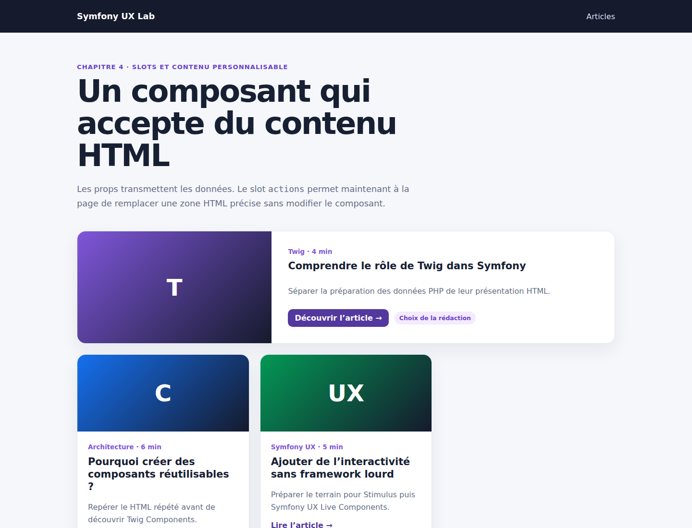

# Symfony UX Twig Components : personnaliser un composant avec les slots

Dans les chapitres précédents, nous avons créé un composant `ArticleCard`, remplacé son tableau générique par des props typées, transmis des attributs HTML et ajouté une variante visuelle.

Il reste une limite : le lien « Lire l’article » est écrit directement dans le composant. Toutes les cartes doivent donc afficher exactement la même action. Dans ce chapitre, nous allons rendre cette petite zone personnalisable avec un **slot**, sans perdre la structure commune du composant.

Le code complet est disponible sur GitHub :

<https://github.com/amine-betari/symfony-ux-lab>

## Le résultat

Démarrer le laboratoire puis ouvrir :

<http://localhost:8480/articles>



La première carte affiche « Découvrir l’article » et le badge « Choix de la rédaction ». Les deux autres conservent le lien par défaut « Lire l’article ».

## Le problème initial

Le composant contenait directement son lien :

```twig
<a class="article-card__link" href="{{ path('app_article_show', {slug}) }}">
    Lire l’article →
</a>
```

Ce code convient tant que toutes les cartes ont la même action. Mais ajouter un badge ou changer le lien pour une seule carte obligerait la page à dupliquer le composant, ou le composant à accumuler des conditions.

Un slot permet au composant de déclarer une zone que son utilisateur pourra remplacer.

## Déclarer un slot avec un contenu par défaut

Dans `templates/components/ArticleCard.html.twig`, nous entourons le lien d’un bloc nommé `actions` :

```twig
<div class="article-card__actions">
    
        <a
            class="article-card__link"
            href="{{ path('app_article_show', {slug}) }}"
        >
            Lire l’article →
        </a>
    
</div>
```

Le nom du slot est `actions`. Le lien situé entre `` et `` constitue son contenu par défaut.

Si la page ne fournit rien, ce lien reste affiché. Le composant demeure donc simple à utiliser :

```twig
<twig:ArticleCard
    :slug="article.slug"
    :title="article.title"
    :excerpt="article.excerpt"
    :category="article.category"
    :readingTime="article.readingTime"
    :icon="article.icon"
    :accent="article.accent"
/>
```

Comme le composant est fermé directement avec `/>`, aucun slot n’est remplacé.

## Remplacer le slot pour une carte

Pour personnaliser la première carte, nous ouvrons le composant et transmettons un `<twig:block>` portant le même nom :

```twig
<twig:ArticleCard
    :slug="article.slug"
    :title="article.title"
    :excerpt="article.excerpt"
    :category="article.category"
    :readingTime="article.readingTime"
    :icon="article.icon"
    :accent="article.accent"
    variant="featured"
>
    <twig:block name="actions">
        <a
            class="article-card__link article-card__link--primary"
            href="{{ path('app_article_show', {slug: article.slug}) }}"
        >
            Découvrir l’article →
        </a>

        <span class="article-card__badge">
            Choix de la rédaction
        </span>
    </twig:block>
</twig:ArticleCard>
```

Le contenu de `<twig:block name="actions">` remplace uniquement le bloc `actions`. Le titre, le résumé, la catégorie, l’icône et toute la structure de la carte continuent de provenir du composant.

Le slot ne remplace donc pas le composant. Il remplace seulement la zone que le composant a volontairement rendue personnalisable.

## Personnaliser uniquement la première carte

Dans notre boucle, `loop.first` permet d’utiliser le slot seulement au premier passage :

```twig

    
        {# composant ouvert avec le slot actions personnalisé #}
    
        {# composant fermé directement : contenu par défaut #}
    

```

Nous obtenons ainsi :

```text
Carte 1 → slot personnalisé
Carte 2 → contenu par défaut
Carte 3 → contenu par défaut
```

## Props, attributes et slots

Ces trois mécanismes sont complémentaires.

### Les props transmettent des données

```twig
:title="article.title"
:readingTime="article.readingTime"
variant="featured"
```

Elles correspondent aux propriétés déclarées dans la classe PHP du composant.

### Le sac attributes configure la balise HTML racine

```twig
id="article-principal"
class="homepage-card"
data-card-index="1"
```

Ces attributs sont rendus grâce à `{{ attributes }}` ou `attributes.defaults()` dans le template du composant.

### Le slot transmet un morceau de HTML

```twig
<twig:block name="actions">
    <a>Découvrir l’article</a>
    <span>Choix de la rédaction</span>
</twig:block>
```

La règle à retenir est :

```text
prop        → une valeur structurée
attributes  → les attributs de la balise HTML racine
slot        → un morceau de HTML placé dans une zone précise
```

Les trois peuvent être utilisés simultanément sur le même appel de composant.

## Tester les deux comportements

Le test fonctionnel vérifie que les trois cartes possèdent une zone d’actions, mais qu’une seule contient le badge personnalisé :

```php
self::assertCount(3, $crawler->filter('.article-card__actions'));
self::assertCount(1, $crawler->filter('.article-card__badge'));
self::assertSame(
    'Choix de la rédaction',
    $crawler->filter('.article-card__badge')->text()
);
```

Il vérifie également le contenu personnalisé de la première carte et le contenu par défaut de la deuxième :

```php
self::assertSame(
    'Découvrir l’article →',
    trim($crawler->filter('.article-card')->first()->filter('.article-card__link')->text())
);

self::assertSame(
    'Lire l’article →',
    trim($crawler->filter('.article-card')->eq(1)->filter('.article-card__link')->text())
);
```

Lancer les tests avec :

```bash
docker compose exec app php bin/phpunit
```

Le laboratoire valide actuellement 4 tests et 19 assertions.

## Quand utiliser un slot ?

Un slot est adapté lorsque le composant doit contrôler sa structure générale tout en laissant une zone HTML libre : actions, en-tête, pied de carte, badge ou barre d’outils.

Pour une simple valeur comme un titre, un nombre ou une variante, une prop reste plus claire. Il ne faut pas transformer toutes les données en slots.

## Bilan

Notre `ArticleCard` conserve une structure et un comportement par défaut. Une page peut maintenant personnaliser sa zone `actions` sans copier son HTML complet ni ajouter une condition métier dans le composant.

Nous avons donc franchi une étape importante : le composant n’est plus seulement réutilisable, il devient **composable**.
