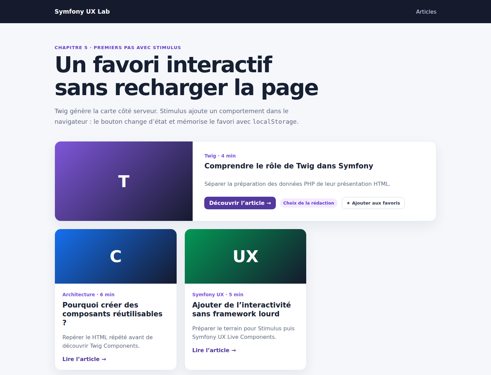

# Symfony UX Stimulus : créer un favori sans recharger la page

Nos Twig Components produisent maintenant des cartes réutilisables, configurables et composables. Mais leur HTML reste statique après son arrivée dans le navigateur.

Dans ce chapitre, nous ajoutons notre premier comportement Stimulus : un bouton permet d’ajouter un article aux favoris, change immédiatement de libellé et conserve son état après un rechargement grâce à `localStorage`.

Le code complet est disponible sur GitHub :

<https://github.com/amine-betari/symfony-ux-lab>

## Le résultat

Démarrer le laboratoire puis ouvrir :

<http://localhost:8480/articles>



Cliquer sur « Ajouter aux favoris » transforme le bouton en « Retirer des favoris ». Aucun rechargement et aucun appel au serveur ne sont nécessaires.

## Le rôle de Stimulus

Twig et Stimulus interviennent à deux moments différents :

```text
Twig       → construit le HTML côté serveur
Stimulus   → ajoute un comportement côté navigateur
```

Stimulus ne remplace donc ni Symfony, ni Twig Components. Il se connecte au HTML déjà produit et réagit aux actions de l’utilisateur.

## Installer Symfony UX Stimulus

Le laboratoire utilise AssetMapper et Importmap. Nous installons le bundle avec Composer :

```bash
docker run --rm \
    --user "$(id -u):$(id -g)" \
    -e COMPOSER_HOME=/tmp/composer \
    -v "$PWD:/app" \
    -w /app \
    composer:2 require symfony/stimulus-bundle
```

La recette Symfony ajoute notamment :

- `assets/stimulus_bootstrap.js` pour démarrer Stimulus ;
- `assets/controllers/` pour nos contrôleurs JavaScript ;
- `@hotwired/stimulus` dans `importmap.php` ;
- `StimulusBundle` dans `config/bundles.php`.

Le fichier principal charge ensuite le démarrage de Stimulus :

```javascript
// assets/app.js
import './stimulus_bootstrap.js';
import './styles/app.css';
```

## Connecter la carte à un contrôleur

Sur la première `ArticleCard`, nous ajoutons deux attributs HTML :

```twig
<twig:ArticleCard
    :slug="article.slug"
    :title="article.title"
    :excerpt="article.excerpt"
    :category="article.category"
    :readingTime="article.readingTime"
    :icon="article.icon"
    :accent="article.accent"
    variant="featured"
    data-controller="favorite"
    data-favorite-key-value="{{ article.slug }}"
>
```

`data-controller="favorite"` demande à Stimulus de connecter le contrôleur `favorite_controller.js` à cette carte.

`data-favorite-key-value` transmet le slug au contrôleur. Stimulus l’exposera sous la forme `this.keyValue`.

Ces données passent par le sac `attributes` du Twig Component et sont rendues sur sa balise `<article>` racine. Les notions vues dans les chapitres précédents fonctionnent donc ensemble.

## Déclarer l’action et les targets

Le bouton se trouve dans le slot `actions` :

```twig
<button
    type="button"
    class="favorite-button"
    aria-pressed="false"
    data-favorite-target="button"
    data-action="favorite#toggle"
>
    ★
    <span data-favorite-target="label">
        Ajouter aux favoris
    </span>
</button>
```

Trois informations sont importantes :

- `data-action="favorite#toggle"` appelle la méthode `toggle()` lors du clic ;
- `data-favorite-target="button"` donne accès au bouton avec `this.buttonTarget` ;
- `data-favorite-target="label"` donne accès au texte avec `this.labelTarget`.

Le HTML reste lisible : il décrit directement le contrôleur utilisé, l’action déclenchée et les éléments ciblés.

## Créer le contrôleur favorite

Le fichier `assets/controllers/favorite_controller.js` commence par déclarer ses targets et sa value :

```javascript
import { Controller } from '@hotwired/stimulus';

export default class extends Controller {
    static targets = ['button', 'label'];

    static values = {
        key: String,
    };
}
```

La correspondance est la suivante :

```text
data-favorite-target="button"  → this.buttonTarget
data-favorite-target="label"   → this.labelTarget
data-favorite-key-value="..."  → this.keyValue
```

## Restaurer l’état à la connexion

Stimulus appelle automatiquement `connect()` lorsque le contrôleur est attaché au DOM :

```javascript
connect() {
    this.active = localStorage.getItem(this.storageKey) === 'true';
    this.render();
}
```

Nous lisons l’état précédemment enregistré, puis nous mettons l’interface à jour.

La clé inclut le slug afin que chaque article puisse posséder son propre état :

```javascript
get storageKey() {
    return `favorite:${this.keyValue}`;
}
```

Pour l’article `comprendre-twig`, la clé devient donc :

```text
favorite:comprendre-twig
```

## Réagir au clic

La méthode `toggle()` inverse l’état et l’enregistre :

```javascript
toggle() {
    this.active = !this.active;

    localStorage.setItem(
        this.storageKey,
        String(this.active)
    );

    this.render();
}
```

Le navigateur conserve `localStorage` entre deux chargements de page. Ce stockage reste toutefois local au navigateur : il n’est ni synchronisé avec un compte utilisateur, ni envoyé au serveur.

## Mettre l’interface à jour

Une seule méthode centralise le rendu du bouton :

```javascript
render() {
    this.buttonTarget.setAttribute(
        'aria-pressed',
        String(this.active)
    );

    this.buttonTarget.classList.toggle(
        'is-active',
        this.active
    );

    this.labelTarget.textContent = this.active
        ? 'Retirer des favoris'
        : 'Ajouter aux favoris';
}
```

Elle met à jour trois choses :

1. `aria-pressed` pour représenter l’état du bouton ;
2. la classe CSS `is-active` pour son apparence ;
3. son libellé visible.

## Le cycle complet

```text
La page charge
    ↓
Stimulus trouve data-controller="favorite"
    ↓
connect() lit localStorage
    ↓
L’utilisateur clique
    ↓
data-action appelle toggle()
    ↓
toggle() enregistre puis appelle render()
```

## Vérifier le HTML côté Symfony

Le test fonctionnel vérifie que le contrat entre Twig et Stimulus est bien rendu :

```php
self::assertCount(
    1,
    $crawler->filter('[data-controller="favorite"]')
);

self::assertCount(
    1,
    $crawler->filter('[data-action="favorite#toggle"]')
);

self::assertCount(
    1,
    $crawler->filter('[data-favorite-target="button"]')
);
```

Ces assertions ne remplacent pas un test JavaScript complet. Elles garantissent que Symfony produit les attributs nécessaires à la connexion de Stimulus.

Le comportement a également été vérifié dans un vrai navigateur :

```text
avant le clic         → Ajouter aux favoris / false
après le clic         → Retirer des favoris / true
après rechargement    → Retirer des favoris / true
```

## Les quatre notions à retenir

```text
controller → connecte un comportement à un élément HTML
action     → relie un événement à une méthode
target     → référence un élément du contrôleur
value      → transmet une donnée typée au contrôleur
```

## Bilan

Nous avons ajouté une interaction ciblée sans transformer toute la page en application JavaScript. Symfony et Twig continuent de produire le contenu ; Stimulus améliore seulement l’expérience dans le navigateur.

Ce premier contrôleur reste volontairement local. Une prochaine étape pourra ajouter plusieurs favoris et un compteur avant de découvrir les Live Components pour les interactions qui nécessitent le serveur.
