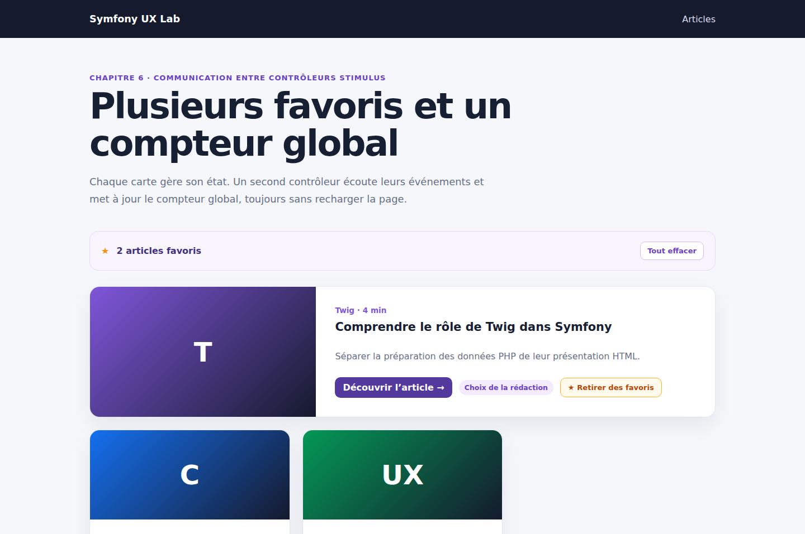

# Symfony UX Stimulus : faire communiquer plusieurs contrôleurs avec des événements

Dans le chapitre précédent, un unique contrôleur Stimulus gérait le bouton favori d’une carte et enregistrait son état dans `localStorage`.

Nous allons maintenant placer un bouton sur chaque `ArticleCard`, afficher le nombre total de favoris et permettre leur réinitialisation. Pour éviter de créer un contrôleur géant, chaque carte reste autonome et communique avec un contrôleur global grâce aux événements Stimulus.

Le code complet est disponible sur GitHub :

<https://github.com/amine-betari/symfony-ux-lab>

## Le résultat

Démarrer le laboratoire puis ouvrir :

<http://localhost:8480/articles>



Chaque carte possède son bouton. Le compteur est actualisé immédiatement, les favoris survivent au rechargement et « Tout effacer » remet toute l’interface à zéro.

## L’objectif architectural

Nous voulons séparer deux responsabilités :

```text
favorite_controller
    → gère une seule carte

favorites_counter_controller
    → compte tous les favoris
```

Le contrôleur d’une carte ne doit pas connaître le HTML du compteur. Il annonce simplement que son état a changé. Le compteur écoute cette annonce et se recalcule.

```text
Clic sur une carte
        ↓
favorite#toggle()
        ↓
événement favorite:changed
        ↓
favorites-counter#refresh()
        ↓
compteur mis à jour
```

## Connecter chaque ArticleCard

Le template du Twig Component fournit maintenant des attributs Stimulus par défaut :

```twig
<article {{ attributes.defaults({
    class: 'article-card article-card--' ~ variant,
    'data-controller': 'favorite',
    'data-favorite-key-value': slug,
    'data-action': 'favorites:cleared@window->favorite#clear'
}) }}>
```

Chaque carte reçoit donc :

- son propre contrôleur `favorite` ;
- le slug comme identifiant de stockage ;
- une écoute de l’événement global `favorites:cleared`.

Le sac `attributes` vu dans les chapitres précédents permet toujours à la page d’ajouter d’autres classes ou attributs HTML.

## Ajouter le bouton à toutes les cartes

Le bouton favori est placé après le slot `actions` :

```twig
<div class="article-card__actions">
    
        <a href="{{ path('app_article_show', {slug}) }}">
            Lire l’article →
        </a>
    

    <button
        type="button"
        class="favorite-button"
        aria-pressed="false"
        data-favorite-target="button"
        data-action="favorite#toggle"
    >
        ★
        <span data-favorite-target="label">
            Ajouter aux favoris
        </span>
    </button>
</div>
```

Le slot reste personnalisable, mais le bouton favori est désormais commun à toutes les variantes du composant.

## Émettre un événement depuis une carte

Après avoir changé et enregistré son état, le contrôleur `favorite` appelle `dispatch()` :

```javascript
toggle() {
    this.active = !this.active;
    localStorage.setItem(this.storageKey, String(this.active));
    this.render();

    this.dispatch('changed', {
        detail: {
            key: this.keyValue,
            active: this.active,
        },
    });
}
```

Comme l’identifiant du contrôleur est `favorite`, Stimulus préfixe automatiquement le nom fourni. `changed` devient donc :

```text
favorite:changed
```

L’événement contient aussi un objet `detail`. Le compteur actuel n’en a pas besoin, mais cette information permettrait à un autre composant de connaître la carte concernée et son nouvel état.

## Installer le contrôleur du compteur

Le contrôleur global est placé sur le parent qui contient toutes les cartes :

```twig
<main
    class="container"
    data-controller="favorites-counter"
    data-action="favorite:changed->favorites-counter#refresh"
>
```

Cette action signifie :

```text
quand favorite:changed est reçu
            ↓
appeler favorites-counter#refresh
```

Les événements personnalisés remontent dans le DOM. Une carte située à l’intérieur de `<main>` peut donc être entendue par ce parent sans référence directe entre les deux contrôleurs.

## Afficher le résumé

Le compteur utilise trois targets :

```twig
<aside class="favorites-summary" aria-live="polite">
    <strong>
        <span data-favorites-counter-target="count">0</span>
        <span data-favorites-counter-target="label">
            article favori
        </span>
    </strong>

    <button
        type="button"
        data-favorites-counter-target="reset"
        data-action="favorites-counter#clear"
        hidden
    >
        Tout effacer
    </button>
</aside>
```

`aria-live="polite"` aide les technologies d’assistance à annoncer les changements du compteur sans interrompre brutalement la lecture.

## Calculer les favoris

Le contrôleur recherche les clés `localStorage` qui commencent par `favorite:` :

```javascript
get favoriteKeys() {
    return Object.keys(localStorage).filter(
        (key) => key.startsWith('favorite:'),
    );
}
```

La méthode `refresh()` ne conserve que les valeurs actives :

```javascript
refresh() {
    const count = this.favoriteKeys.filter(
        (key) => localStorage.getItem(key) === 'true',
    ).length;

    this.countTarget.textContent = String(count);
    this.labelTarget.textContent = count > 1
        ? 'articles favoris'
        : 'article favori';
    this.resetTarget.hidden = count === 0;
}
```

`connect()` appelle cette méthode au chargement : le compteur retrouve donc immédiatement les favoris enregistrés lors d’une visite précédente.

## Tout réinitialiser

Le compteur supprime les clés puis envoie un événement global :

```javascript
clear() {
    this.favoriteKeys.forEach(
        (key) => localStorage.removeItem(key),
    );

    window.dispatchEvent(
        new CustomEvent('favorites:cleared'),
    );

    this.refresh();
}
```

Pourquoi l’événement est-il envoyé sur `window` ? Un événement classique remonte d’un enfant vers ses parents. Ici, le compteur doit prévenir plusieurs cartes situées plus bas dans le DOM. `window` sert de point de communication commun.

Chaque carte écoute cet événement avec :

```twig
data-action="favorites:cleared@window->favorite#clear"
```

Sa méthode `clear()` remet uniquement son interface à zéro :

```javascript
clear() {
    this.active = false;
    this.render();
}
```

## Tester le contrat Twig

Le test fonctionnel vérifie que trois contrôleurs `favorite` et un contrôleur global sont présents :

```php
self::assertCount(
    1,
    $crawler->filter('[data-controller="favorites-counter"]')
);

self::assertCount(
    3,
    $crawler->filter('[data-controller="favorite"]')
);

self::assertCount(
    3,
    $crawler->filter('[data-action="favorite#toggle"]')
);
```

Il vérifie également les deux événements :

```php
self::assertCount(
    1,
    $crawler->filter(
        '[data-action="favorite:changed->favorites-counter#refresh"]'
    )
);

self::assertCount(
    3,
    $crawler->filter(
        '[data-action="favorites:cleared@window->favorite#clear"]'
    )
);
```

## Vérification dans Chromium

Le scénario complet a aussi été exécuté dans un vrai navigateur :

```text
Départ             → 0 favori
Premier clic       → 1 favori
Deuxième clic      → 2 favoris
Après rechargement → 2 favoris
Tout effacer       → 0 favori
```

Les tests Symfony valident actuellement 4 tests et 29 assertions.

## Pourquoi ne pas utiliser directement Live Components ?

Ici, toutes les données peuvent rester dans le navigateur. Aucun compte utilisateur, contrôle métier ou enregistrement en base n’est nécessaire. Stimulus suffit donc largement.

Un Live Component deviendra utile lorsque le clic devra appeler Symfony, vérifier des permissions, enregistrer un favori en base ou partager le même état entre plusieurs appareils.

```text
État uniquement local       → Stimulus
État géré par Symfony       → Live Component
```

## Bilan

Nous avons appris à faire collaborer plusieurs petits contrôleurs sans les coupler directement :

- `favorite` gère une carte ;
- `favorites-counter` gère le résumé ;
- `favorite:changed` remonte vers le parent ;
- `favorites:cleared` est diffusé via `window` ;
- `localStorage` conserve l’état entre deux chargements.

Nous avons maintenant les bases nécessaires pour passer progressivement aux Symfony UX Live Components.
